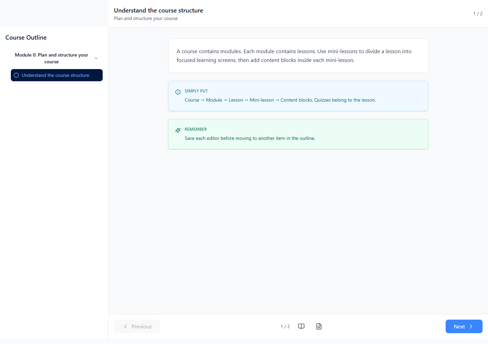
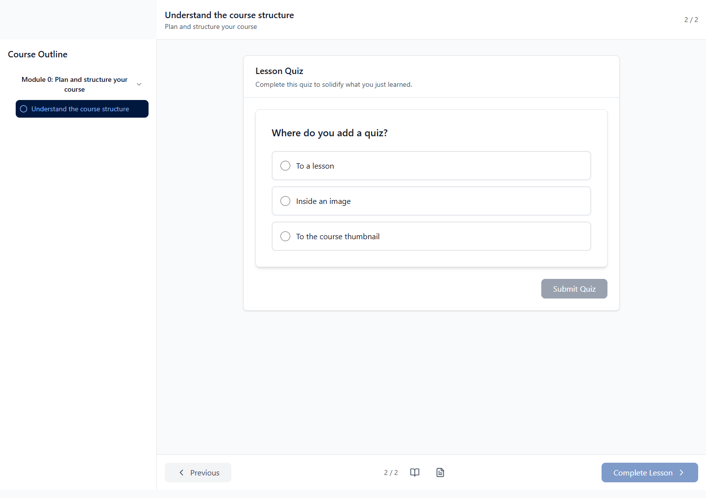
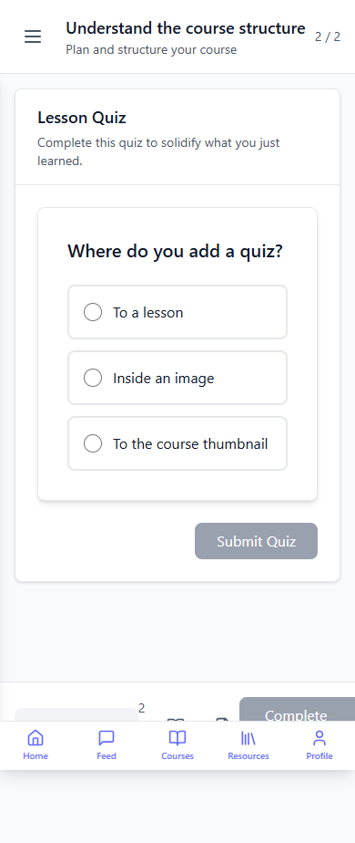

# UniVybe course creation manual

Local draft for educators and tutors · 26 October 2026

Use this manual to plan, build, check and prepare a UniVybe course for approval. The companion training draft uses the same course hierarchy and provides practice tasks and worked quiz examples. It has not been imported or published.

## How to use this manual

Work through the modules in order and build a small practice course as you go. Complete the task at the end of each lesson. Use the student screenshots to understand the learner view, then verify the real course in a controlled student session.

The screenshots were captured from the existing Edu_Student_g1 student build on 26 October 2026 with illustrative API responses. They show actual interface screens, not a published training course or verified grading results.

## Student portal walkthrough

Open the course overview to check the title, description and curriculum. Open a lesson to see mini-lessons and quizzes as successive screens. The outline shows the learning sequence; Next advances through the current lesson. Completing a lesson and saving progress are separate from simply viewing its screens.

Student course overview with illustrative training content. Illustrative data.

Student lesson showing plain text Simply put and Remember blocks. Illustrative data.

Student quiz with one correct choice before submission. Illustrative data.

The same quiz on a narrow mobile screen. Illustrative data.

## Module 1 Plan a course learners can complete

Define the audience and a useful outcome.

### Lesson 1.1 Choose the audience and outcome

Learning outcome: Write an observable outcome and a small course outline.

Start with what an educator or tutor should be able to do after the course. For this manual, the outcome is to create, preview and submit a complete UniVybe course with appropriate content and quizzes.

Write outcomes using actions you can observe: create, explain, solve or demonstrate. For example: Create one module containing a lesson, a mini-lesson, content blocks and a quiz. Avoid an outcome such as Understand everything about teaching.

Identify what learners already know, what they need to bring, and which device they will use. Keep each lesson focused on one outcome. Estimate the time only after drafting and walking through the activities.

Remember: Try it yourself
Write a course title, target audience, two learning objectives and one prerequisite. Sketch two modules with one focused lesson in each.

### Lesson 1.2 Understand the UniVybe course structure

Learning outcome: Put each item in the correct place in the course outline.

A course is the full learning experience. Modules divide it into topics. Lessons sit inside modules. Mini-lessons divide each lesson into focused screens. Text and media blocks sit inside a mini-lesson.

Quizzes belong directly to a lesson, alongside its mini-lessons. They do not belong inside a content block. The student player builds screens from mini-lessons and quizzes.

The Academic module field in course details links an official university registry entry. It is different from the modules you create as chapters in this course.

Simply put: Course → Module → Lesson → Mini-lesson → Content blocks
Lesson → Quizzes

Remember: Try it yourself
Draw your course tree and mark where a quiz belongs.

Quiz example — mcq

Where do you add a quiz?

Choices: To a lesson | Inside a content block | To the course thumbnail

Answer key: To a lesson

Explanation: A lesson holds mini-lessons and quizzes.

## Module 2 Create the draft and build the outline

Create a small complete learning path before adding more material.

### Lesson 2.1 Create course details

Learning outcome: Save a course draft with clear learner facing information.

Open Courses and create a course. Enter the title and description, then save. These are required in the current frontend. State who the course is for, what learners will do and what they need before starting. Use the short description as a concise summary.

Choose General for a broad audience, or the appropriate academic level. Not set leaves the level unspecified. Add university, faculty, department, organization or an official academic module only when relevant; an organization course does not require a university context.

Add learning objectives, prerequisites and tags using one item per line. Add a cover URL or use the upload controls where available. Check that the image is readable on a small screen and that you have permission to use it.

Estimated hours and lesson or quiz counts describe the intended scope. Check them against the final outline. Pricing and coin rewards entered by creators are suggestions; an admin sets final pricing and rewards.

Remember: Try it yourself
Create a practice draft with a specific title, a useful description and two learning objectives. Save it and confirm that it appears in Courses.

### Lesson 2.2 Build modules lessons and mini lessons

Learning outcome: Save and reorder a module containing one complete lesson.

In the course outline, choose Add module. Give it a topic title and save. Expand that module, choose Add lesson, set its title and lesson type, and save. Reading, video and mixed describe the lesson; media itself is added as content blocks.

Expand the lesson and choose Add mini-lesson. Give the screen a meaningful title and save. Expand it and choose Add content block. Add one plain text block first, save, then preview the course.

Each editor saves separately. Save before choosing a different outline item. Use the saved confirmation to distinguish a confirmed save from a retained unsaved draft. Moving away with unsaved changes opens a save or discard decision.

Use drag handles or Move up and Move down to reorder siblings. Order applies within the selected parent. After an interrupted reorder, reload and inspect the saved sequence before trying again.

Remember: Try it yourself
Build one module with a reading lesson and two mini-lessons. Add a text block to each, reorder them and verify the result in preview.

Quiz example — one word

What holds a lesson in the course outline? Answer with one singular word.

Answer key: module

Explanation: A module contains lessons.

## Module 3 Use every supported content type

Choose a format that supports the learning task.

### Lesson 3.1 Write text explanations and reminders

Learning outcome: Use the four explanation styles with a clear purpose.

Choose Content type text, then choose the text style. Plain is the default for explanations, instructions and worked examples. Break long passages into focused mini-lessons instead of placing the whole course in one block.

Simply put gives a simpler restatement after an explanation. Important highlights a consequence or condition. Remember reinforces something learners need to carry into the next activity. Keep these blocks brief so their emphasis remains useful.

A learning objective describes something the learner can demonstrate.

Simply put: Write what the learner will do.

Important: Only add media you are allowed to share with learners.

Remember: Save each content block before moving to another item.

Remember: Try it yourself
Teach one idea using plain text, then add a simpler restatement, one important condition and one reminder.

### Lesson 3.2 Add formulas links and copyable prompts

Learning outcome: Create a formula a labelled link and a reusable prompt.

For Formula, enter LaTeX and inspect the formula preview. For example, \frac{3}{4} teaches a fraction. Explain the symbols in a nearby plain text block so the formula is meaningful without relying only on the visual.

For Link, enter one complete HTTP or HTTPS address as the content. The optional label is limited to 100 characters on one line and must not contain a web address. Use Check link to confirm the destination. Put longer instructions in a preceding plain text block.

For Prompt, enter plain text learners can copy. Preserve useful line breaks and placeholders. State what to replace before using it, and check the student Copy prompt control. A prompt is a content format rather than a graded quiz.

Formula: \frac{3}{4}

Prompt: Create three practice questions about [TOPIC].
Use beginner level language.
Explain each answer after I attempt it.

Remember: Try it yourself
Create a formula, a labelled course reference link and a prompt with a replaceable topic. Check their previews.

### Lesson 3.3 Add images video embeds and documents

Learning outcome: Select and check each of the four media block types.

Choose Image for an illustration or screenshot. Add a valid media URL or use the lesson media upload controls. Add a caption using advanced metadata when needed. Explain essential visual information in an adjacent text block because captions are not a substitute for verified accessible alternatives.

Choose Video for a demonstration. Paste the media address, including a supported YouTube watch, share or embed URL, rather than iframe code. Provide a short text summary and an accessible transcript or captions, then check playback on desktop and mobile.

Choose Embed for an external interactive resource. Check that the provider allows embedding and that learners can access it without your account. Provide a link or written alternative if embedding is blocked.

Choose Document for a handout or reference file. Explain what learners should do with the file and test opening it as a learner. A document block displays or links media; course level resource attachments are managed separately.

The media URL is required for non-text blocks. Advanced media metadata accepts JSON. Leave existing metadata unchanged unless needed; do not erase unfamiliar saved properties. For a caption, an example is {"caption":"Course outline example"}.

Remember: Try it yourself
Add one image, one short video, one allowed embed and one document from your own approved materials. Test every address and include a text alternative.

## Module 4 Build useful quizzes

Create examples of every authorable quiz type.

### Lesson 4.1 Write multiple choice questions

Learning outcome: Create questions with one or several correct choices.

Expand a lesson and choose Add quiz. Choose Multiple choice, write a clear question, add at least two distinct choices and tick every correct choice. For a single correct answer, tick only one. For multiple correct answers, say Select all that apply in the question.

Use plausible incorrect choices that reveal a misunderstanding. Avoid trick wording or choices that differ only in punctuation. Add an explanation describing why the answer is correct and what the learner should revisit.

Open optional settings only when needed. A blank time limit means untimed. Empty reward and attempt fields keep existing values or use server defaults for new quizzes. These defaults need to be confirmed with the backend before making learner promises.

Remember: Try it yourself
Create one question with one correct choice and another with two correct choices. Inspect the answer key in preview.

Quiz example — mcq

Select all items that belong directly to a lesson.

Choices: Mini-lessons | Quizzes | Course thumbnails

Answer key: Mini-lessons | Quizzes

Explanation: Mini-lessons and quizzes belong to a lesson; blocks belong to mini-lessons.

### Lesson 4.2 Write short answer and one word questions

Learning outcome: Choose accepted answers that fit the intended response.

Short answer accepts a short response and alternative wording. Add the main answer first and use Add alternative answer for valid variations. Keep the prompt specific enough that a short answer can demonstrate the outcome.

One word requires each accepted answer to be a single word. Use alternative answer rows for legitimate spelling or terminology variations. Do not add a sentence to this type.

These controls do not provide a teacher marked essay workflow. Avoid asking for a long explanation and expecting automatic grading. Check correct and incorrect answers in the student portal, including capitalization and spacing, before release.

Remember: Try it yourself
Write one short answer question and one one-word question. Enter a valid alternative answer for the short answer question.

Quiz example — short answer

What should you do before leaving an edited block?

Answer key: Save the block | Save changes

Explanation: Save the current editor before moving on.

Quiz example — one word

Which text style displays mathematical LaTeX?

Answer key: formula

Explanation: Use the formula text style for LaTeX.

### Lesson 4.3 Write fill in the blank and tap to fill questions

Learning outcome: Keep blank answers and word bank choices in the intended order.

For Fill in the blank, write the sentence with blank spaces and enter answers in left to right blank order. Use Add blank answer for another position. Move the answer rows up or down to fix their order.

For Tap to fill, add the word bank first, then select the answer for each blank from that bank. Include useful distractors. Every selected answer must match a word bank entry.

The tutor form does not define a reliable blank marker or count blanks for you. Spaces at the start and end of the question are trimmed by the server. Keep blanks between visible text and verify their display and grading in the student portal. The draft includes both types for review, but their end to end release is gated on the compatibility checks in the review log.

Remember: Try it yourself
Create one two-blank question and one tap-to-fill question. Check answer order, then try correct and incorrect submissions in a controlled student session.

Quiz example — fill blank

A course contains  and a module contains .

Answer key: modules | lessons

Explanation: The hierarchy is course, module, lesson, mini-lesson, block.

Quiz example — tap fill

Add content blocks to a  and add quizzes to a .

Choices: mini-lesson | lesson | thumbnail

Answer key: mini-lesson | lesson

Explanation: Blocks belong to mini-lessons. Quizzes belong to lessons.

## Module 5 Review submit and maintain the course

Inspect the learner experience and record improvements.

### Lesson 5.1 Review the student experience

Learning outcome: Complete a structured desktop and mobile review.

Use Preview course to inspect the saved content and answer review. This preview helps with authoring; it does not prove enrollment, grading, progress, media access or publication behavior in the student portal.

In a controlled student session, inspect the course summary, open the first lesson and read every mini-lesson. Test links, copy prompts, formulas and media on desktop and a small screen. Check text readability and whether the lesson order makes sense.

Try each quiz with correct, incorrect and alternative answers. Confirm the explanation, allowed attempts, next screen behavior and recorded progress. Check lesson completion and access to the next lesson. Do not treat the screenshots in the companion as proof of successful grading; they use illustrative data.

For each difficulty, record the exact action, what you expected, what happened and a suggested change. Separate missing content from an editor problem or student compatibility issue. Retest after each change.

Remember: Try it yourself
Walk through your practice course on desktop and mobile. Record at least one improvement with steps to reproduce and a clear expected result.

### Lesson 5.2 Submit a complete course for approval

Learning outcome: Prepare a course for review and retain a maintenance checklist.

Check the title, description, objectives, prerequisites, counts and estimated time. Confirm every module, mini-lesson, block and quiz that should be visible is marked available where the form provides that setting. Saving a draft and enabling an item are separate from course approval.

Save the current editor before choosing Submit for approval. The creation portal submits the course for review and expects a pending approval status. An admin decision is required; submitting does not by itself make the course public.

After a review decision, inspect the returned status and feedback. Apply the requested corrections and follow the available submission workflow. If a save result is uncertain, use the check saved controls, inspect the server version and avoid repeating a create request that might duplicate content.

Before launch, resolve the quiz compatibility checks, replace all pending media and screenshots, and complete the controlled student walkthrough. Keep a dated record of content changes, broken link repairs and learner feedback.

Remember: Try it yourself
Prepare your course checklist and submit only when the actual course is complete. This local training draft remains unpublished.

## Coverage and assets before release

All five authorable quiz types are included: multiple choice, short answer, one word, fill in the blank and tap to fill. Multiple choice includes a single answer example and a multiple answer example. True or false can be written with two choices; the tutor editor does not offer a separate true or false or teacher marked essay type.

All five content types are taught: text, image, video, embed and document. All seven text styles are taught: plain, simply put, important, remember, formula, link and prompt. Link and media examples need final approved URLs before they can become valid saved blocks. They are listed as pending assets instead of fake working URLs.

- Use the final published companion document URL with label Course creation companion.

- Upload screenshots/02-student-lesson.png and explain the course outline.

- Record the actual educator workflow with captions and a transcript.

- Choose an approved embeddable learning activity and check learner access.

- Upload course-creation-manual.docx or an approved exported reading copy and use the resulting URL.

## Final course checklist

- [ ] The audience objectives and prerequisites are clear.
- [ ] The saved outline matches the intended module and lesson order.
- [ ] All intended visible items have their availability settings checked.
- [ ] Every text style media type and quiz type has been reviewed.
- [ ] Media and external links work without educator account access.
- [ ] Desktop and mobile reading and navigation have been checked.
- [ ] Correct incorrect and alternative quiz answers have been tested against the real API.
- [ ] Completion progress and next lesson access have been checked.
- [ ] The review log has no unresolved release blocking issues.
- [ ] The course has been submitted for approval only after all editors are saved.
